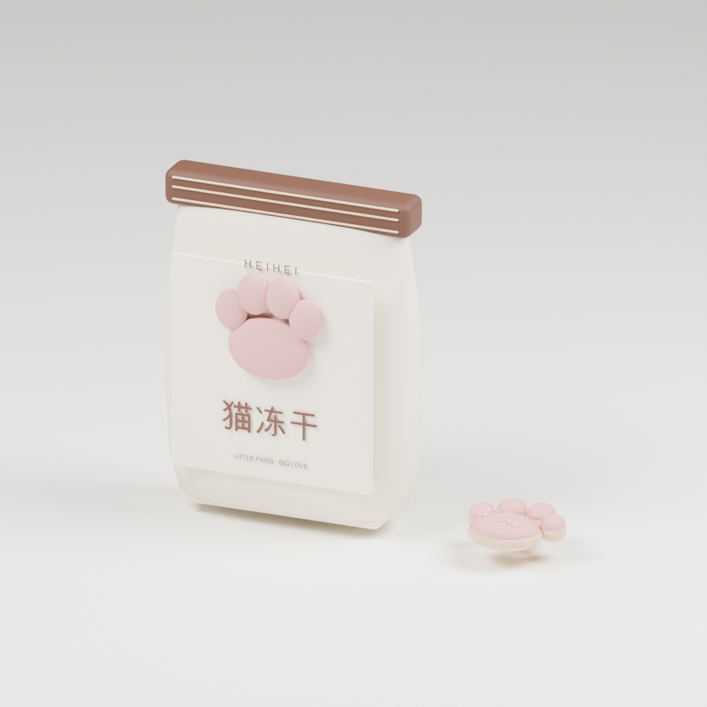

# Interactive Pet · Heihei

[完整交接与恢复手册](HANDOFF.md) · [备份核验记录](qa/backup_verification_2026_11_06.md)

2026-11-06 云端交接：当前代码已包含冻干与逗猫棒切换。GitHub 推送仅同步代码；Pages 部署需手动运行 `Publish interactive pet`，线上页面可能仍为历史版本。

一只可以用冻干零食吸引和投喂的四足暹罗猫。移动鼠标或悬停 Pencil 会拎起米白色冻干袋，快速来回晃动吸引 Heihei 跑来；点一下抛出粉色猫爪冻干。袋子还在时猫优先跟袋子，移开后才会低头把地上的冻干慢慢吃掉。



[当前产品与交互 PRD](PRD.md) · [本版验收记录](qa/web/acceptance_feeding_v1.md) · [历史逗猫棒规格](PRD_wand_v2.md)

## 本地运行和部署

安装 Node.js 20.19+，在 `web/` 内运行：

```sh
npm ci
npm run dev
```

打开 `http://localhost:5179/`。`npm test` 验证模型和互动；`npm run build` 输出 `web/dist/`，完整复制到静态站点即可，模型在构建产物中。当前 GitHub Pages 配置使用 `/interactive-pet/` 路径，改仓库名称时需要同步修改 Vite base。原生 iPad 工程需要自己的 Xcode 签名，默认网页地址仍是公开 Pages；尚未发布的本地修改不会自动出现在原生应用中。

## 怎么玩

左下角可随时选择「逗猫棒 / 冻干」，默认冻干。切换会收起当前道具并清除未吃完的冻干；同一种玩法重新点选也会重新开始。逗猫棒首次选择时加载物理模块，失败可以原地重试或切回冻干。

- **桌面**：移动鼠标拎袋子，上下移动可升降，快晃吸引奔跑，左键投一颗；将鼠标移出场景后，Heihei 才去吃。
- **iPad Pencil**：悬停显示袋子，接触投喂；抬高到悬停范围外后猫去吃。接触结束后的新悬停会恢复袋子。
- **手机触屏**：点一下投喂，松开后猫去吃。普通触屏没有真实手指悬停数据，不模拟不存在的硬件能力。
- **设置**：观察视角、手动动作、参数和本地 CSV 都在右上角；复位会清空已投零食。

## 冻干道具

- [可编辑 Blender 文件](output/cat_treats_v1.blend) / [运行用 GLB](web/public/assets/cat_treats_v1.glb)，含独立的 `TreatBag`、`PawTreat`。
- `blender -b --python src/build_treats_v1.py` 重建。中文标签生成时需要中文字体，默认使用 macOS Arial Unicode，可用 `HEIHEI_LABEL_FONT` 指定字体路径；交付 GLB 里的文字已经转网格，同事运行无需安装字体。
- 逗猫棒使用原有 v3 资产和绳球物理系统，仅选中该玩法时运行。

## 模型文件

| 文件 | 用途 |
| --- | --- |
| [`output/siamese_cat_quadruped_v10.blend`](output/siamese_cat_quadruped_v10.blend) | Blender 5.2 可编辑模型，32 根骨骼、12 个 Action、展示时间线 |
| [`output/siamese_cat_quadruped_v10.glb`](output/siamese_cat_quadruped_v10.glb) | 网页运行用骨骼动画模型 |
| [`output/cat_asset_config_v10.json`](output/cat_asset_config_v10.json) | 骨骼映射、动作名、坐标和交互参数 |
| [`output/cat_wand_v2.blend`](output/cat_wand_v2.blend) | 可编辑逗猫棒：竹杆、绳结、编织球、分层羽片和羽绒丝 |
| [`web/public/assets/cat_wand_v2.glb`](web/public/assets/cat_wand_v2.glb) | 网页用逗猫棒，Rod 与 Lure 可独立摆动 |
| [`output/cat_wand_v3.blend`](output/cat_wand_v3.blend) | V2 可编辑逗猫棒；五片羽毛各有三节骨骼，含可变形羽轴与细绒 |
| [`web/public/assets/cat_wand_v3.glb`](web/public/assets/cat_wand_v3.glb) | 历史逗猫棒 v3 资产；当前投喂入口不加载 |
| [`ios/heihei_hover/HeiheiHover.xcodeproj`](ios/heihei_hover/HeiheiHover.xcodeproj) | Safari 不提供实测悬停姿态时使用的轻量 WKWebView 宿主 |
| [`output/siamese_cat_quadruped_v10.mp4`](output/siamese_cat_quadruped_v10.mp4) | 24.67 秒动作预览 |

Blender 中选中 `Cat_Rig` 并进入 Pose Mode 可以编辑骨骼。要单独修改 Action，先静音 `Quadruped showcase` NLA 轨道。Walk／Run 是原地动画，位移由网页控制。GLB 采用 Y 向上、+Z 朝前，换算尺寸以配置文件为准。

## 源码与当前边界

`web/src/feeding/` 包含输入、袋子与零食、猫行为及本地记录。猫的基础骨骼、动作、头颈追踪与移动控制继续复用。`src/` 保存可重复执行的 Blender 构建与导出；历史逗猫棒版本在 `v1/`、`v2/` 中保留。

体表没有毛发模拟；眼球没有独立转动，注视通过头颈追踪完成。进食采用低头动作加轻微周期姿态叠加，未新增可见张嘴模型。真实 iPad／iPhone 的本版验收仍待设备连接，桌面模拟不替代真机结果。本仓库没有附角色图像、模型或代码的复用许可证。
